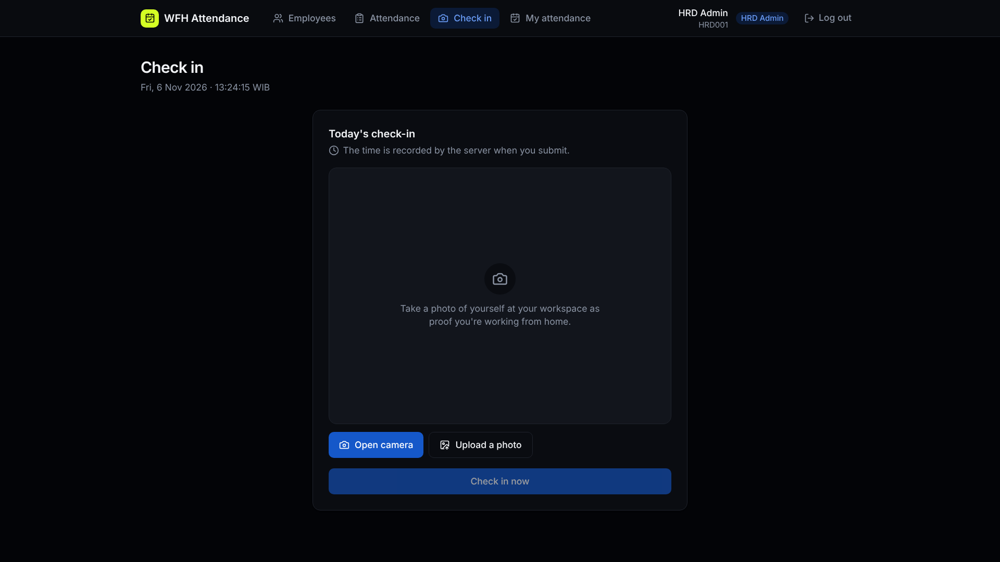
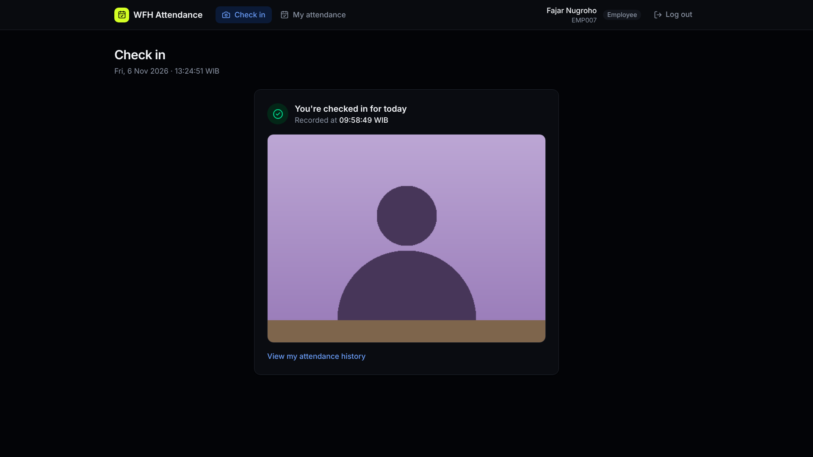
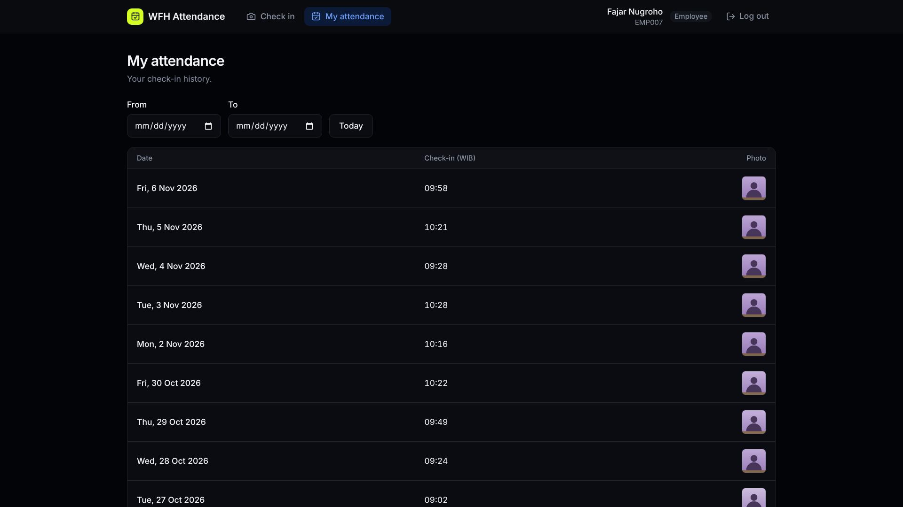
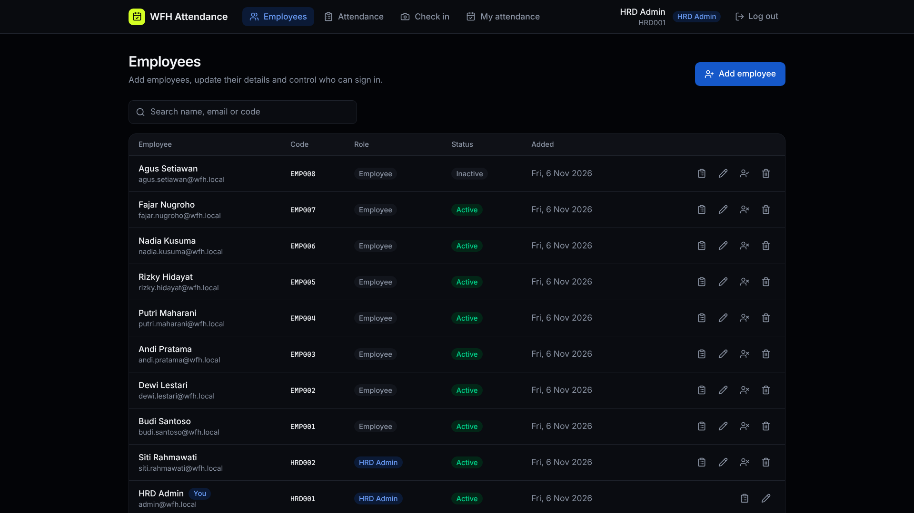
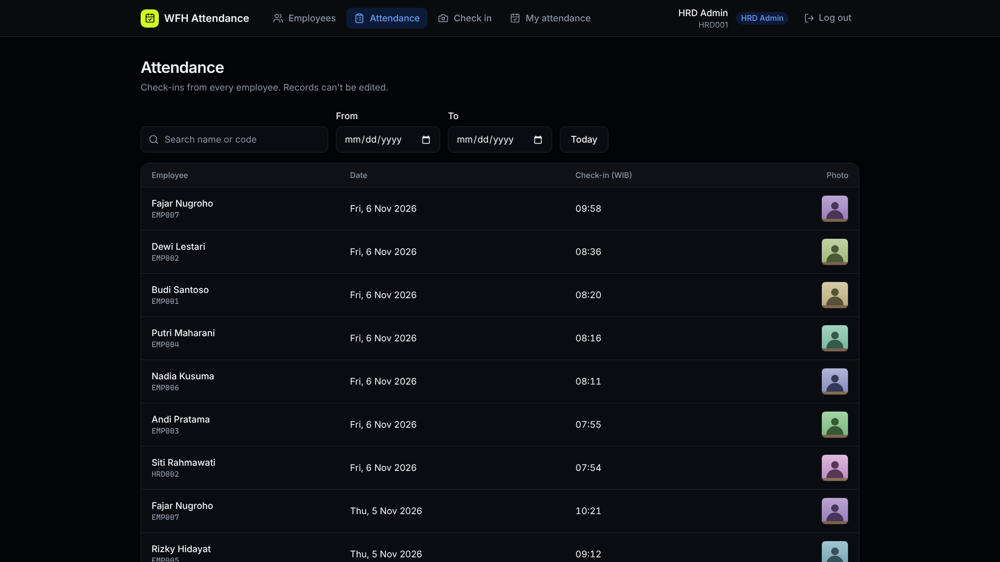

# WFH Attendance - Fullstack Developer Skill Test

This is a project for a Technical Test for Software Engineer position at Dexa Group.

| Workspace                 | What it is                                                                                         | Port |
| ------------------------- | -------------------------------------------------------------------------------------------------- | ---- |
| `apps/gateway`            | HTTP API (prefix `/api`), talks to services                                                        | 3000 |
| `apps/employees-service`  | NestJS TCP microservice, `employees_db`                                                            | 4001 |
| `apps/attendance-service` | NestJS TCP microservice, `attendance_db`                                                           | 4002 |
| `apps/web`                | React + Vite frontend                                                                              | 5173 |
| `packages/contracts`      | `Role`, message patterns, view types; validated DTOs at `/dto`                                     | —    |
| `packages/nest-common`    | Validation options; TCP bootstrap, env schema, TypeORM config, RPC error filter at `/microservice` | —    |

## Quick start

Needs Node 24 and Docker (with Compose v2).

```bash
npm run setup   # once: .env files (JWT_SECRET generated), npm install, MySQL, HRD admin seed
npm run dev     # MySQL + shared-package watchers + all services + web, in one terminal

npm run db:seed:demo #Populate demo employees and attendance records
```

`setup` is safe to re-run; it never overwrites an existing `.env`. The seeded admin comes from
`SEED_ADMIN_*` in `apps/employees-service/.env` (default `admin@wfh.local` / `ChangeMe123!`).

To run a single service in its own terminal instead, use `npm run dev:employees`,
`dev:attendance`, `dev:gateway` or `dev:web` (each builds the shared packages first).
`npm run db:down` stops MySQL; `npm run db:reset` wipes its volume and re-seeds.

## Login credentials

Open <http://localhost:5173>. `npm run setup` creates the HRD admin (defaults from `SEED_ADMIN_*`
in `apps/employees-service/.env`):

| Role      | Email             | Password       |
| --------- | ----------------- | -------------- |
| HRD admin | `admin@wfh.local` | `ChangeMe123!` |

After `npm run db:seed:demo`, these accounts also exist, all with the password `Password123!`:

| Role      | Email                      | Notes                             |
| --------- | -------------------------- | --------------------------------- |
| HRD admin | `siti.rahmawati@wfh.local` |                                   |
| Employee  | `budi.santoso@wfh.local`   |                                   |
| Employee  | `dewi.lestari@wfh.local`   |                                   |
| Employee  | `andi.pratama@wfh.local`   |                                   |
| Employee  | `putri.maharani@wfh.local` |                                   |
| Employee  | `rizky.hidayat@wfh.local`  |                                   |
| Employee  | `nadia.kusuma@wfh.local`   |                                   |
| Employee  | `fajar.nugroho@wfh.local`  |                                   |
| Employee  | `agus.setiawan@wfh.local`  | Deactivated, so login is rejected |

Employees created from the HRD page sign in with the email and password set there.

## Pages

After login, `/` redirects HRD admins to `/admin/employees` and employees to `/check-in`.

| Path                | Access | What it does                                                                           |
| ------------------- | ------ | -------------------------------------------------------------------------------------- |
| `/login`            | guest  | Email + password sign-in                                                               |
| `/check-in`         | any    | Today's check-in: camera capture or photo upload; shows the record once checked in     |
| `/my-attendance`    | any    | Own check-in history with date-range filter, pagination and photo viewer               |
| `/admin/employees`  | HRD    | Employee list with search; add, edit, deactivate and delete; link to their attendance  |
| `/admin/attendance` | HRD    | View-only attendance of all employees: search, date range, per-employee filter, photos |

### Screenshots

**Check in**: before checking in, take a photo with the camera or upload one; the time is
recorded by the server.



Once checked in, today's record and photo are shown instead.



**My attendance**: the employee's own history, filterable by date.



**Employees (HRD)**: search, add, edit, deactivate or delete employees, or jump to their
attendance.



**Attendance (HRD)**: view-only check-ins from every employee, with search and date filters.



## API

Interactive docs (Swagger UI) are at <http://localhost:3000/api/docs>, with the OpenAPI JSON at
`/api/docs/json`; both are disabled when `NODE_ENV=production`. Log in via `POST /auth/login`, then
paste the `accessToken` into **Authorize**.

All routes are under `/api`, need `Authorization: Bearer <token>` unless marked public, and respond
with `{ statusCode, message, data }` (errors: `{ statusCode, message, error, errors? }`).

| Route                       | Access              | Notes                                         |
| --------------------------- | ------------------- | --------------------------------------------- |
| `POST /auth/login`          | public, 5/min       | Returns `{ accessToken, employee }`           |
| `GET /auth/me`              | any                 |                                               |
| `POST /employees`           | HRD                 |                                               |
| `GET /employees`            | HRD                 | `page`, `limit`, `search`                     |
| `GET /employees/:id`        | HRD                 |                                               |
| `PATCH /employees/:id`      | HRD                 | Can't deactivate or demote yourself           |
| `DELETE /employees/:id`     | HRD                 | Soft delete; can't delete yourself            |
| `POST /attendance/check-in` | any active employee | `multipart/form-data`, field `photo` (≤ 5 MB) |
| `GET /attendance/me`        | any                 | `page`, `limit`, `dateFrom`, `dateTo`         |
| `GET /attendance`           | HRD                 | Same, plus `employeeId`, `search`             |
| `GET /attendance/:id/photo` | HRD or owner        |                                               |

One check-in per employee per work day. The server records the time; the work day is computed
in `WORK_TIMEZONE` (default `Asia/Jakarta`). Photos are stored under the gateway's `UPLOAD_DIR`.

## Checks

```bash
npm run lint          # oxlint (type-aware) across all workspaces
npm run format        # prettier, config in .prettierrc
npm run build
npm test
```

Lint, format and git attributes are configured once at the repo root. `apps/web/.oxlintrc.json`
only adds the React rules.
